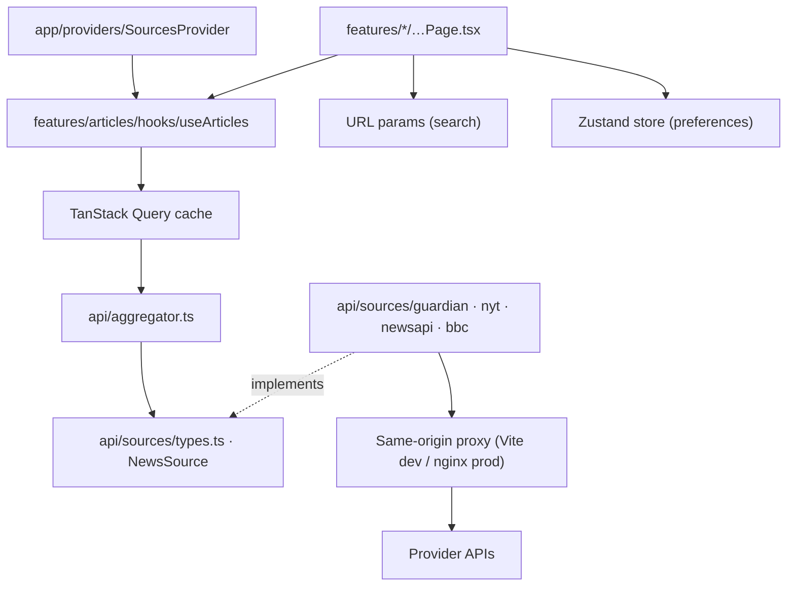

# Architecture

A quick map of the codebase: **what** each technique or feature is, **where** it lives, and **why** it's there.
Start with the index. Every row links to the file that implements it.

## Contents

1. [Feature and technique index](#1-feature-and-technique-index)
2. [Folder structure](#2-folder-structure)
3. [Layers and dependency rules](#3-layers-and-dependency-rules)
4. [Performance and Core Web Vitals](#4-performance-and-core-web-vitals)
5. [Accessibility (WCAG 2.2 AA)](#5-accessibility-wcag-22-aa)
6. [What we deliberately did not use](#6-what-we-deliberately-did-not-use)
7. [SOLID, DRY, KISS in practice](#7-solid-dry-kiss-in-practice)
8. [Adding a news source](#8-adding-a-news-source)
9. [Security notes](#9-security-notes)

Related docs: [DATA_FLOW](DATA_FLOW.md) (request lifecycle, state ownership) · [DESIGN](DESIGN.md) (tokens, CSS architecture, BEM) · [DECISIONS](DECISIONS.md) (ADRs) · [TESTING](TESTING.md) · [CODE_GUIDELINES](CODE_GUIDELINES.md)

---

## 1. Feature and technique index

### Product features

| Feature                         | What it does                                                     | Where                                                                                                                                                                                                                |
| ------------------------------- | ---------------------------------------------------------------- | -------------------------------------------------------------------------------------------------------------------------------------------------------------------------------------------------------------------- |
| Keyword search                  | Live search across all providers, debounced 400 ms               | [`SearchPage.tsx`](../src/features/search/SearchPage.tsx), [`useDebouncedValue.ts`](../src/hooks/useDebouncedValue.ts)                                                                                               |
| Filters: date, category, source | Stored in the URL, validated on read                             | [`FilterBar.tsx`](../src/features/search/components/FilterBar/FilterBar.tsx), [`searchParams.ts`](../src/features/search/searchParams.ts), [`useSearchFilters.ts`](../src/features/search/hooks/useSearchFilters.ts) |
| Personalised feed               | Preferred sources and topics. Followed authors are ranked first. | [`FeedPage.tsx`](../src/features/feed/FeedPage.tsx), [`rankByAuthors.ts`](../src/features/feed/rankByAuthors.ts)                                                                                                     |
| Preferences                     | Persisted to `localStorage`                                      | [`PreferencesPage.tsx`](../src/features/preferences/PreferencesPage.tsx), [`preferencesStore.ts`](../src/features/preferences/preferencesStore.ts)                                                                   |
| Follow an author from a card    | One click on any article                                         | [`ArticleCard.tsx`](../src/features/articles/components/ArticleCard/ArticleCard.tsx)                                                                                                                                 |
| Four news providers             | Guardian, NYT, NewsAPI, BBC RSS                                  | [`src/api/sources/`](../src/api/sources)                                                                                                                                                                             |
| Partial-failure handling        | One broken provider never blanks the page                        | [`aggregator.ts`](../src/api/aggregator.ts), [`SourceNotice.tsx`](../src/features/articles/components/SourceNotice/SourceNotice.tsx)                                                                                 |

### React and data techniques

| Technique                                                                         | Where                                                                                                                                                      | Why                                                                                                                  |
| --------------------------------------------------------------------------------- | ---------------------------------------------------------------------------------------------------------------------------------------------------------- | -------------------------------------------------------------------------------------------------------------------- |
| **TanStack Query `useInfiniteQuery`** (caching, dedupe, cancellation, pagination) | [`useArticles.ts`](../src/features/articles/hooks/useArticles.ts)                                                                                          | Server state without hand-written effects. Each filter combination is cached for 5 min.                              |
| **Infinite scroll** (IntersectionObserver) **+ "Load more" fallback**             | [`useInfiniteScroll.ts`](../src/hooks/useInfiniteScroll.ts), [`ArticleResults.tsx`](../src/features/articles/components/ArticleResults/ArticleResults.tsx) | Auto-loads up to 3 pages, prefetching 800px early. Then the button takes over, so the footer stays reachable (a11y). |
| **Debounce** (not throttle)                                                       | [`useDebouncedValue.ts`](../src/hooks/useDebouncedValue.ts)                                                                                                | One request per typing pause. Throttle would also send partial words.                                                |
| **`keepPreviousData`**                                                            | [`useArticles.ts`](../src/features/articles/hooks/useArticles.ts)                                                                                          | Old results stay visible (dimmed, `aria-busy`) while new filters load: no skeleton flash, no CLS.                    |
| **Route code-splitting: `React.lazy` + `Suspense`**                               | [`routes.tsx`](../src/app/routes.tsx), [`AppLayout.tsx`](../src/components/AppLayout/AppLayout.tsx)                                                        | Search and Preferences are separate chunks. The landing feed stays in the main bundle for LCP.                       |
| **Route preloading on intent**                                                    | [`routes.tsx`](../src/app/routes.tsx) (`preloadRoute`), nav `onMouseEnter`/`onFocus`/`onTouchStart`                                                        | The chunk is usually cached before the click, so the Suspense fallback is rarely seen.                               |
| **Error boundary per route**                                                      | [`ErrorBoundary.tsx`](../src/components/ErrorBoundary/ErrorBoundary.tsx)                                                                                   | A crashed page or a failed chunk load shows a recoverable message. It resets on navigation (`key={pathname}`).       |
| **React 19 `<title>` in components**                                              | Each page component                                                                                                                                        | Unique, dynamic document titles (WCAG 2.4.2) with no helmet library                                                  |
| **React 19 `use(Context)` and `<Context value>`**                                 | [`SourcesProvider.tsx`](../src/app/providers/SourcesProvider.tsx)                                                                                          | Current React idioms                                                                                                 |
| **Dependency injection via context**                                              | [`SourcesProvider.tsx`](../src/app/providers/SourcesProvider.tsx)                                                                                          | Tests and Storybook inject fake providers without mocking modules or the network.                                    |
| **`React.memo` + stable object identity**                                         | [`ArticleCard.tsx`](../src/features/articles/components/ArticleCard/ArticleCard.tsx)                                                                       | "Load more" appends cards without re-rendering existing ones.                                                        |
| **Narrow Zustand selectors**                                                      | `FollowAuthorButton`, `FeedPage`                                                                                                                           | Following an author re-renders only the cards by that author.                                                        |
| **URL as state**                                                                  | [`useSearchFilters.ts`](../src/features/search/hooks/useSearchFilters.ts)                                                                                  | Shareable, refresh-safe, back-button friendly                                                                        |
| **Focus management on navigation**                                                | [`useRouteChangeFocus.ts`](../src/hooks/useRouteChangeFocus.ts)                                                                                            | Scrolls to the top and focuses `<main>` after client-side navigation (WCAG 2.4.3).                                   |
| **Web Vitals reporting**                                                          | [`reportWebVitals.ts`](../src/app/reportWebVitals.ts)                                                                                                      | Logs LCP, INP and CLS in dev, or with `?vitals` in production. Lazy chunk.                                           |

### Styling techniques

| Technique                                                                                | Where                                                                                                 | Why                                                                        |
| ---------------------------------------------------------------------------------------- | ----------------------------------------------------------------------------------------------------- | -------------------------------------------------------------------------- |
| **Design tokens** (Sass maps → CSS custom properties)                                    | [`_tokens.scss`](../src/styles/abstracts/_tokens.scss), [`_root.scss`](../src/styles/base/_root.scss) | One source of truth, taken from innoscripta.com                            |
| **BEM naming in CSS Modules**                                                            | every `*.module.scss`, [`bem.ts`](../src/lib/bem.ts)                                                  | Readable `block__element--modifier` names, scoped so they never collide    |
| **Sass partials, `@use`/`@forward`, mixins, `%placeholders` + `@extend`, `@if`/`@each`** | [`src/styles/abstracts/`](../src/styles/abstracts)                                                    | Reuse, inheritance and conditional logic, with build errors on token typos |
| **Cascade layers `@layer`**                                                              | [`main.scss`](../src/styles/main.scss)                                                                | Predictable precedence: reset < base < utilities < components              |
| **Container queries**                                                                    | `ArticleCard`, `PreferencesPage`                                                                      | Components adapt to their own width, not the viewport.                     |
| **Intrinsic grid + `clamp()`**                                                           | `ArticleResults`, `_functions.scss` (`fluid()`)                                                       | Responsive from 320px to 4K without breakpoints                            |
| **`content-visibility: auto`**                                                           | `.article-results__item`                                                                              | Native "virtualisation": off-screen cards skip layout and paint.           |
| **Metric-matched fallback font**                                                         | [`_fonts.scss`](../src/styles/base/_fonts.scss)                                                       | Font swap without layout shift (CLS)                                       |

## 2. Folder structure

Organised **by feature**: everything for one feature lives together, and shared code sits in clearly named top-level folders. Each component has its own folder holding its TSX, SCSS module, stories and tests.

```
src/
├── main.tsx                     Entry: fonts, global styles, render <App>, optional web-vitals
├── app/                         App shell (wiring only, no UI of its own)
│   ├── App.tsx                  Providers: QueryClient + Router
│   ├── routes.tsx               Route table, lazy pages, route preloading
│   ├── queryClient.ts           TanStack Query defaults
│   ├── reportWebVitals.ts       Core Web Vitals logger (lazy)
│   └── providers/SourcesProvider.tsx   DI context for news sources
├── config/constants.ts          All tunables: page size, debounce, cache time, infinite-scroll limits
├── domain/                      Source-agnostic types and labels (no React, no fetch)
├── api/                         Everything that talks to the network
│   ├── http.ts                  fetch wrapper, HttpError, user-facing error messages
│   ├── aggregator.ts            Parallel fan-out, merge, de-dupe, failure reporting
│   └── sources/                 One adapter per provider + NewsSource interface + registry + queryMatcher
├── features/                    One folder per product feature
│   ├── articles/                Shared article UI: ArticleCard, ArticleResults, SourceNotice, skeletons; useArticles
│   ├── feed/                    "/" page + author ranking
│   ├── search/                  "/search" page, FilterBar, URL ⇄ filters
│   └── preferences/             "/preferences" page + persisted store
├── components/                  Reusable, feature-agnostic UI (Button, ChipToggle, PageHeader, AppLayout, …)
├── hooks/                       Reusable hooks (debounce, infinite scroll, route focus)
├── lib/                         Pure helpers (bem, cx, dates, text, collections)
├── styles/                      Design system: abstracts/ (tokens, functions, mixins, placeholders) + base/
├── stories/                     Storybook-only: fixtures, token docs, full-page stories
└── test/                        Test helpers: fakes, render with providers, fetch mock
```

**Naming conventions.** `PascalCase.tsx` for components, `useCamelCase.ts` for hooks, `camelCase.ts` for helpers, `X.module.scss`, `X.stories.tsx` and `X.test.ts(x)` sit beside `X`. Imports use the `@/` alias (= `src/`), except sibling files (`./X.module.scss`).

## 3. Layers and dependency rules



| Layer                | May import                                                       | Must not import                 |
| -------------------- | ---------------------------------------------------------------- | ------------------------------- |
| `domain/`, `config/` | nothing                                                          | anything else                   |
| `lib/`               | nothing app-specific                                             | `features/`, `api/`, components |
| `api/`               | `domain/`, `config/`, `lib/`                                     | React, `features/`, components  |
| `hooks/`             | `config/`, `lib/`                                                | `features/`, `api/`             |
| `components/`        | `lib/`, `config/`, `hooks/`, `domain/`, other components         | `features/`, `api/`             |
| `features/`          | everything above, plus another feature's public components/hooks | another feature's internals     |
| `app/`               | everything (it wires it all together)                            | —                               |
| `styles/` (SCSS)     | only within `styles/`                                            | —                               |

Components never import a concrete adapter. Sources come from `useNewsSources()`.

## 4. Performance and Core Web Vitals

Measured on the production build (`vite preview`, with `?vitals`, using Google's `web-vitals` library). These are local numbers without network throttling:

| Metric  | Result                    | Good threshold | What protects it                                                                                                                                                                                                                                            |
| ------- | ------------------------- | -------------- | ----------------------------------------------------------------------------------------------------------------------------------------------------------------------------------------------------------------------------------------------------------- |
| **LCP** | 724 ms (first card image) | ≤ 2.5 s        | Feed not lazy-loaded. First 3 card images `loading="eager"` + `fetchpriority="high"`, the rest `lazy`. Poppins 400/600 `<link rel="preload">` injected at build ([`vite.config.ts`](../vite.config.ts)). Self-hosted woff2 (about 8 kB each, latin subset). |
| **INP** | 40 ms                     | ≤ 200 ms       | Debounced search requests. `keepPreviousData` (no tear-down/re-mount). `React.memo` cards. Narrow store selectors. `content-visibility: auto` keeps off-screen layout cheap. Lazy routes keep the main bundle small.                                        |
| **CLS** | 0.000                     | ≤ 0.1          | Image `width`/`height` + CSS `aspect-ratio`. Skeletons match the card grid. `PageFallback` matches the `PageHeader` size. Metric-matched `Poppins Fallback`. `scrollbar-gutter: stable`. Old results kept during refetch.                                   |

Other wins: route chunks (Search about 2 kB gz, Preferences about 1.2 kB gz), immutable caching for hashed `/assets/` in nginx, and gzip.

## 5. Accessibility (WCAG 2.2 AA)

| WCAG criterion                             | Implementation                                                                                                                                                                     |
| ------------------------------------------ | ---------------------------------------------------------------------------------------------------------------------------------------------------------------------------------- |
| 1.1.1 Non-text content                     | Decorative images `alt=""` inside an `aria-hidden` link. Icons `aria-hidden`.                                                                                                      |
| 1.3.1 Info and relationships               | Semantic landmarks (`header`, `nav`, `main`, `footer`), `article`, `time`, lists, `fieldset`/`legend`, labelled sections. Heading outline h1 → h2 (visually hidden on lists) → h3. |
| 1.4.3 Contrast (minimum)                   | Every pairing ≥ 4.5:1 (large text ≥ 3:1). Brand colours adjusted where needed ([DESIGN §4](DESIGN.md#4-colour-and-accessibility-trade-offs)).                                      |
| 1.4.10 Reflow / 1.4.4 Resize               | Works at 320px and at 200% zoom. Breakpoints in `em`. Fluid type.                                                                                                                  |
| 2.1.1 Keyboard                             | Only native buttons, links and inputs. Infinite scroll has a "Load more" fallback.                                                                                                 |
| 2.4.1 Bypass blocks                        | "Skip to content" link                                                                                                                                                             |
| 2.4.2 Page titled                          | React 19 `<title>` per route (including the search keyword)                                                                                                                        |
| 2.4.3 Focus order                          | Focus moves to `<main>` after navigation                                                                                                                                           |
| 2.4.7 / 2.4.11 Focus visible, not obscured | 3px focus ring (system colour in forced-colors mode). `scroll-padding` clears the sticky header and tab bar.                                                                       |
| 2.5.8 Target size                          | Interactive targets ≥ 32px (most are 40–44px)                                                                                                                                      |
| 3.3.2 Labels                               | Every field has a `<label>` (visually hidden where the design needs it)                                                                                                            |
| 4.1.2 Name, role, value                    | `aria-pressed` toggles, `aria-expanded`/`aria-controls` disclosure, "(opens in a new tab)" in link names                                                                           |
| 4.1.3 Status messages                      | Result counts, loading and partial failures use `role="status"`                                                                                                                    |
| Preferences                                | `prefers-reduced-motion`, `prefers-contrast: more`, `forced-colors`                                                                                                                |

Storybook's A11y addon runs axe on every story.

## 6. What we deliberately did not use

| Suggestion                                             | Decision                         | Reason                                                                                                                                                                                                                                                                            |
| ------------------------------------------------------ | -------------------------------- | --------------------------------------------------------------------------------------------------------------------------------------------------------------------------------------------------------------------------------------------------------------------------------- |
| **Redux / RTK**                                        | Not used                         | Server state belongs in TanStack Query (cache, refetch, pagination) and preferences are about 40 lines of Zustand. Redux would add a third store and boilerplate with nothing left for it to own. I'd reach for RTK if many features shared complex, interdependent client state. |
| **JS virtualisation** (react-window, TanStack Virtual) | CSS `content-visibility` instead | Lists are capped by pagination (3 auto pages, then manual). A responsive multi-column grid with variable-height cards is awkward to virtualise, and `content-visibility` gets most of the rendering win for free. Switch if lists regularly exceed about 500 cards.               |
| **Throttle for search**                                | Debounce                         | Throttle sends intermediate queries ("cli", "clim"). Debounce sends only the final one.                                                                                                                                                                                           |
| **`useTransition` on filters**                         | Not used                         | A transition would delay the chip's own pressed state until the results re-render. `keepPreviousData` already keeps the UI responsive (INP 40 ms).                                                                                                                                |
| **React Compiler**                                     | Not used                         | It isn't yet wired into this Vite 8 / plugin-react setup. Targeted `memo` on the one hot component is clearer.                                                                                                                                                                    |

## 7. SOLID, DRY, KISS in practice

| Principle                 | Where                                                                                                                                                                                                                |
| ------------------------- | -------------------------------------------------------------------------------------------------------------------------------------------------------------------------------------------------------------------- |
| **S**ingle responsibility | Adapters only translate. The aggregator only combines. `ArticleResults` only renders list states. `SourceNotice` and `ArticleSkeletonGrid` are their own components. URL parsing is pure and separate from its hook. |
| **O**pen/closed           | A new provider is one file plus one registry line. No `switch (source)` exists in the UI.                                                                                                                            |
| **L**iskov substitution   | Real adapters, test fakes and Storybook fakes all satisfy `NewsSource` interchangeably.                                                                                                                              |
| **I**nterface segregation | `NewsSource` has one method. Components take narrow props.                                                                                                                                                           |
| **D**ependency inversion  | `useArticles` and `aggregate` depend on the `NewsSource` abstraction, injected via context. `AppLayout` receives `onNavigationIntent` instead of importing the router's preloaders.                                  |
| **DRY**                   | One data hook, one results component, one query matcher, one `bem()` helper. Constants live in `config/`. `SOURCE_IDS` defines both the type and the defaults.                                                       |
| **KISS**                  | No Redux, no custom fetch layer, no virtualisation library, no barrel files.                                                                                                                                         |

**Complexity notes:** de-duplication uses a `Set`, O(n). Merging sorts once, O(n log n). `rankByAuthors` is a single-pass stable partition, O(n·a). `createQueryMatcher` normalises the keyword once, not per article. Source selection uses a `Set` lookup.

## 8. Adding a news source

1. Create `src/api/sources/<name>.ts` exporting `build<Name>Url(query)` (pure), `map<Name>Response(json)` (pure, returns `SourcePage`) and `<name>Source: NewsSource`. Use `createQueryMatcher` for filters the provider can't apply.
2. Add the id to `SOURCE_IDS` in `src/domain/article.ts` and the source to `src/api/sources/registry.ts`.
3. Add proxy routes to **both** `vite.config.ts` and `docker/nginx.conf.template`, plus an env var in `.env.example`.
4. Add `src/api/sources/<name>.test.ts`.

The `source-adapter-builder` agent does exactly this.

## 9. Security notes

- API keys live only in server-side env (Vite proxy or nginx), never `VITE_`-prefixed, so they can't end up in the bundle.
- Provider HTML snippets are converted to plain text (`toPlainText`). There is no `dangerouslySetInnerHTML`.
- External links use `rel="noopener noreferrer"`. URL params are validated before use.
