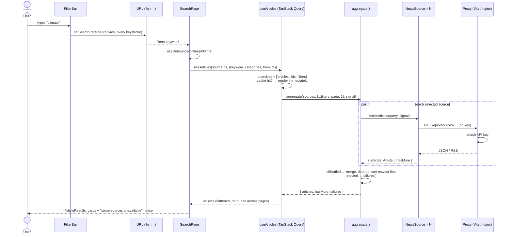
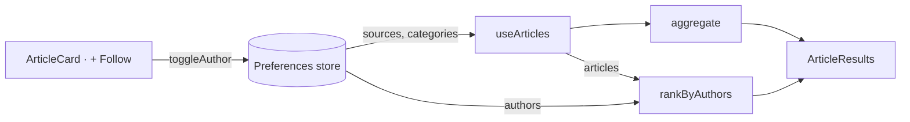

# Data flow

## Where state lives

Each kind of state has exactly one owner. Nothing is copied between them.

| State                                                | Owner                                          | Why there                                                                  |
| ---------------------------------------------------- | ---------------------------------------------- | -------------------------------------------------------------------------- |
| Search filters (keyword, category, dates, sources)   | **URL** query string via `useSearchFilters`    | Shareable links, refresh-safe, back button works                           |
| Preferences (sources, categories, followed authors)  | **Zustand** store, persisted to `localStorage` | Survives reloads. Read by the feed page and by every card's Follow button. |
| Articles from providers                              | **TanStack Query** cache                       | Server state: cached 5 min, de-duplicated, cancellable                     |
| Transient UI (author input draft, image-failed flag) | Local `useState`                               | Only one component cares                                                   |

## Search: keystroke to cards



Details worth knowing:

- **Only the request is debounced, not the input.** The URL updates on every keystroke (with `replace`, so history isn't spammed), and `SearchPage` debounces the value it passes to the query. There is no local input state to keep in sync with the URL.
- **Stale requests are cancelled.** TanStack Query aborts the previous `signal` when the key changes, and every adapter passes the signal to `fetch`.
- **No flash between filter changes.** `placeholderData: keepPreviousData` keeps the old results visible (dimmed, `aria-busy`) while the new ones load.
- **Pagination:** infinite scroll (`useInfiniteScroll`) auto-loads up to 3 pages as the list end approaches. After that, “Load more” calls `fetchNextPage`, which runs `aggregate` with `page + 1`. A source that is exhausted returns `hasMore: false`. The button shows while any source has more.

## Personalised feed



- The feed reuses the same `useArticles` hook, with `categories` from preferences and no keyword.
- Followed authors are a **ranking** step after fetching (`rankByAuthors`), not part of the request. Following someone re-orders the feed instantly with no network call.
- Changing sources or categories changes the query key, so the feed refetches (or serves from cache).

## How each provider maps a query

|          | Keyword                                                           | Date range                                             | Categories                                           | Pages                     |
| -------- | ----------------------------------------------------------------- | ------------------------------------------------------ | ---------------------------------------------------- | ------------------------- |
| Guardian | `q`                                                               | `from-date`/`to-date`                                  | `section=a\|b`                                       | `page` (1-based)          |
| NYT      | `q`                                                               | `begin_date`/`end_date` (YYYYMMDD)                     | `fq=section_name:("A" "B")`                          | `page` (0-based, 10/page) |
| NewsAPI  | `/everything?q` when there's no category, else `/top-headlines?q` | `/everything` only, filtered client-side for headlines | `/top-headlines?category` (one request per category) | `page`                    |
| BBC      | client-side `createQueryMatcher`                                  | client-side                                            | one RSS feed per category                            | single page               |

## Errors

```
fetch → !res.ok → HttpError(status, provider message)
      → adapter rejects → allSettled marks it failed
      → aggregator → describeError(): 401/403 "API key missing or invalid", 429 "Rate limit reached"
      → failures[] → <SourceNotice> (role="status") above the results
```

The page only shows an empty state when _no_ source returned articles. Partial results are always shown.
