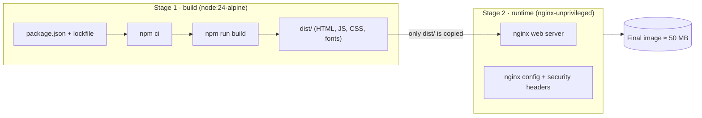
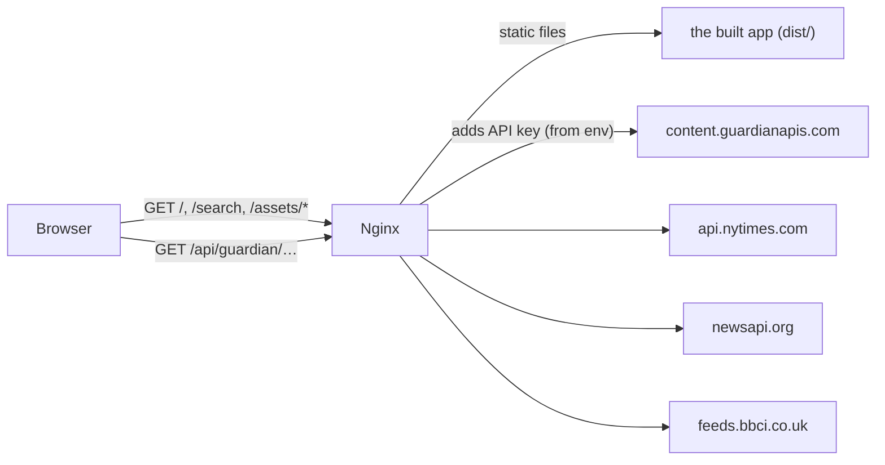

# Docker guide (for beginners)

This guide explains **what Docker does in this project**, **how it's set up**, and **how to check that it works**, step by step. You don't need any previous Docker experience.

## Contents

1. [Docker in 2 minutes](#1-docker-in-2-minutes)
2. [How this project uses Docker](#2-how-this-project-uses-docker)
3. [The files, line by line](#3-the-files-line-by-line)
4. [Install Docker (macOS)](#4-install-docker-macos)
5. [Run the app](#5-run-the-app)
6. [Verify it works: checklist](#6-verify-it-works-checklist)
7. [Add API keys](#7-add-api-keys)
8. [Everyday commands](#8-everyday-commands)
9. [Troubleshooting](#9-troubleshooting)

---

## 1. Docker in 2 minutes

| Word                         | Plain-English meaning                                                                               | In this project                                               |
| ---------------------------- | --------------------------------------------------------------------------------------------------- | ------------------------------------------------------------- |
| **Image**                    | A packaged, read-only snapshot of an app plus everything it needs to run (like a "frozen" computer) | `news-aggregator:latest`: the built website plus a web server |
| **Container**                | A running copy of an image. You can start, stop and delete it without affecting the image.          | The thing serving <http://localhost:8080>                     |
| **Dockerfile**               | The recipe that builds the image                                                                    | [`Dockerfile`](../Dockerfile)                                 |
| **Docker Compose**           | A file that says _how to run_ the container (ports, settings), so you type one command              | [`docker-compose.yml`](../docker-compose.yml)                 |
| **Port mapping** `8080:8080` | "Port 8080 on my Mac goes to port 8080 inside the container"                                        | You open `localhost:8080`                                     |
| **Environment variable**     | A setting passed in when the container starts                                                       | The API keys                                                  |

**Why use Docker?** "It works on my machine" goes away. The interviewer gets exactly the same setup you tested, without installing Node or knowing anything about the project.

## 2. How this project uses Docker

The image is built in **two stages** (a _multi-stage build_):



Stage 1 is thrown away after building, so Node, `node_modules` and the source code **don't end up** in the final image. That makes the image small and safe.

When the container runs, **nginx** does two jobs:



1. **Web server:** it serves the website, and sends any unknown path (like `/search`) to `index.html`, so page refreshes work in a single-page app.
2. **API proxy:** the browser calls `/api/guardian/...` on the same server. nginx adds the secret API key and forwards the request to The Guardian. **The key never reaches the browser.**

## 3. The files, line by line

### `Dockerfile`: the recipe

| Line                                                                        | What it does                                                                                                                                                                                                         |
| --------------------------------------------------------------------------- | -------------------------------------------------------------------------------------------------------------------------------------------------------------------------------------------------------------------- |
| `FROM node:24-alpine AS build`                                              | Start stage 1 from a small Linux image that has Node 24                                                                                                                                                              |
| `COPY package.json package-lock.json ./` then `RUN npm ci --ignore-scripts` | Install exact dependency versions. Copying these two files first lets Docker **cache** the install, so rebuilds after code changes are fast. `--ignore-scripts` blocks install scripts from dependencies (security). |
| `COPY . .` then `RUN npm run build`                                         | Copy the source and build the production site into `dist/`                                                                                                                                                           |
| `FROM nginxinc/nginx-unprivileged:1.27-alpine AS runtime`                   | Start stage 2 from nginx that runs as a **non-root** user (safer)                                                                                                                                                    |
| `ENV GUARDIAN_API_KEY="" …`                                                 | Default (empty) keys. Real ones are supplied when the container starts, not baked into the image.                                                                                                                    |
| `COPY docker/… /etc/nginx/…`                                                | Add our nginx config, security headers and proxy rules                                                                                                                                                               |
| `COPY --from=build /app/dist /usr/share/nginx/html`                         | Take **only** the built site from stage 1                                                                                                                                                                            |
| `EXPOSE 8080`                                                               | Documents that the container listens on port 8080                                                                                                                                                                    |
| `HEALTHCHECK …`                                                             | Every 30 s Docker checks that the site answers. `docker ps` then shows `healthy`.                                                                                                                                    |

### `docker-compose.yml`: how to run it

```yaml
services:
  web:
    build: . # build the image from the Dockerfile in this folder
    image: news-aggregator:latest
    ports:
      - '8080:8080' # Mac port 8080 → container port 8080
    env_file:
      - path: .env # load API keys from .env, if the file exists
        required: false
    restart: unless-stopped # restart automatically if it crashes
```

### `docker/` folder: nginx configuration

| File                    | Purpose                                                                                                                                        |
| ----------------------- | ---------------------------------------------------------------------------------------------------------------------------------------------- |
| `nginx.conf.template`   | The server config. At start-up nginx replaces `${GUARDIAN_API_KEY}` and the other key placeholders with the real values from your environment. |
| `api-proxy.conf`        | Rules for every `/api/*` route: GET only, rate limit (5 requests/second per visitor), visitor cookies are not forwarded                        |
| `security-headers.conf` | Browser security headers (Content-Security-Policy and others) added to every response                                                          |

### `.dockerignore`

Like `.gitignore`, but for Docker. It keeps `node_modules`, `dist`, `.git` and **`.env`** (your keys) out of the build, so secrets can never end up inside the image.

## 4. Install Docker (macOS)

1. Download **Docker Desktop for Mac**: <https://www.docker.com/products/docker-desktop/>
   - On an **Apple Silicon** Mac (M1–M4), choose **"Mac with Apple chip"**. Run `uname -m`: `arm64` means Apple chip.
2. Open the `.dmg`, drag Docker to Applications, then launch **Docker** from Applications.
3. Accept the terms and wait until the whale icon in the menu bar says **"Docker Desktop is running"**.
4. Check it in Terminal:

```bash
docker --version
```

```bash
docker compose version
```

```bash
docker run --rm hello-world
```

The last command should print "Hello from Docker!". If it does, Docker works.

## 5. Run the app

Open Terminal in the project folder:

```bash
cd ~/Desktop/UIWork/innoscripta-news-aggregator
```

Build the image and start the container (the first run takes 1–3 minutes):

```bash
docker compose up --build
```

When the log shows nginx lines like `start worker processes`, open **<http://localhost:8080>**. You should see the Newsroom feed with BBC News articles.

To stop it, press `Ctrl + C` in that Terminal window.

**Run in the background** (`-d` = detached), then stop it later:

```bash
docker compose up --build -d
```

```bash
docker compose down
```

## 6. Verify it works: checklist

With the container running, open a **second** Terminal window and run these one at a time. Each one tells you what you should see.

**1. The container is running and healthy.** After about 30 s, `STATUS` should say `(healthy)`:

```bash
docker compose ps
```

**2. The website is served.** This should print `200`:

```bash
curl -s -o /dev/null -w "%{http_code}\n" http://localhost:8080/
```

**3. Page refresh works on deep links (SPA fallback).** This should print `200`:

```bash
curl -s -o /dev/null -w "%{http_code}\n" "http://localhost:8080/search?q=climate"
```

**4. The API proxy works (BBC needs no key).** This should print `<rss` followed by XML:

```bash
curl -s http://localhost:8080/api/bbc/news/rss.xml | head -c 200
```

**5. Security headers are present.** You should see `content-security-policy`, `x-content-type-options: nosniff`, `x-frame-options: DENY` and `referrer-policy`:

```bash
curl -sI http://localhost:8080/ | grep -iE "content-security|x-content-type|x-frame|referrer"
```

**6. The proxy is read-only.** A POST request must be refused, so this should print `403`:

```bash
curl -s -o /dev/null -w "%{http_code}\n" -X POST http://localhost:8080/api/bbc/news/rss.xml
```

**7. The container doesn't run as root.** This should print a number that is **not** `0` (usually `101`):

```bash
docker compose exec web id -u
```

**8. Secrets aren't baked into the image.** Inspect the _image_ (not the running container). Every key should be empty, like `GUARDIAN_API_KEY=`:

```bash
docker image inspect news-aggregator --format '{{range .Config.Env}}{{println .}}{{end}}' | grep API_KEY
```

Then check that the _running container_ received your keys from `.env`. This prints only `set` or `empty`, never the key itself:

```bash
docker compose exec web sh -c 'for v in GUARDIAN_API_KEY NYT_API_KEY NEWSAPI_API_KEY; do eval "x=\$$v"; [ -n "$x" ] && echo "$v=set" || echo "$v=empty"; done'
```

> Avoid `docker compose exec web env`. It prints your real keys to the terminal, where they can end up in screenshots or shell history.

**9. In the browser:** open <http://localhost:8080>, open DevTools (`Cmd + Option + I`), go to **Network**, and click a request to `/api/bbc/...`. Under **Response Headers** you'll see the security headers, and the request URL contains **no API key**.

If all nine checks pass, Docker is set up correctly. GitHub Actions runs the same checks automatically on every push (the `docker` job in [`.github/workflows/ci.yml`](../.github/workflows/ci.yml)).

## 7. Add API keys

1. Copy the template and add your keys (see the links in the README):

```bash
cp .env.example .env
```

2. Open `.env` and fill in `GUARDIAN_API_KEY=…`, `NYT_API_KEY=…` and `NEWSAPI_API_KEY=…`.
3. Restart the container. **No rebuild is needed**, because keys are read when the container starts:

```bash
docker compose up -d --force-recreate
```

4. Reload <http://localhost:8080>. The "API key missing" notice disappears for each provider you added.

`.env` is ignored by git **and** by Docker, so your keys are never committed or copied into the image.

## 8. Everyday commands

| Task                              | Command                                                   |
| --------------------------------- | --------------------------------------------------------- |
| Start (build if needed)           | `docker compose up --build`                               |
| Start in the background           | `docker compose up --build -d`                            |
| See logs                          | `docker compose logs -f web` (`Ctrl + C` stops following) |
| Status / health                   | `docker compose ps`                                       |
| Stop and remove the container     | `docker compose down`                                     |
| Rebuild from scratch (no cache)   | `docker compose build --no-cache`                         |
| Open a shell inside the container | `docker compose exec web sh` (type `exit` to leave)       |
| Image size                        | `docker images news-aggregator`                           |
| Free disk space (unused images)   | `docker system prune`                                     |

**Without Compose** (the same thing, done by hand):

```bash
docker build -t news-aggregator .
```

```bash
docker run --rm -p 8080:8080 --env-file .env news-aggregator
```

## 9. Troubleshooting

| Problem                                                | Fix                                                                                                                                 |
| ------------------------------------------------------ | ----------------------------------------------------------------------------------------------------------------------------------- |
| `docker: command not found`                            | Docker Desktop isn't installed or isn't running. Start it from Applications and wait for "running".                                 |
| `Cannot connect to the Docker daemon`                  | Docker Desktop is still starting. Wait for the whale icon to stop animating.                                                        |
| `port is already allocated` / `address already in use` | Something else uses port 8080. Stop it, or change `'8080:8080'` to `'3000:8080'` in `docker-compose.yml` and open `localhost:3000`. |
| Changed code but don't see it                          | Rebuild: `docker compose up --build`. (Plain `up` reuses the old image.)                                                            |
| Added keys but still see "API key missing"             | Run `docker compose up -d --force-recreate`, and check the variable names in `.env`.                                                |
| Container restarts repeatedly                          | Run `docker compose logs web`. nginx prints the exact config error.                                                                 |
| BBC articles don't load                                | The container needs internet access. Check that `curl https://feeds.bbci.co.uk/news/rss.xml` works on your Mac.                     |
